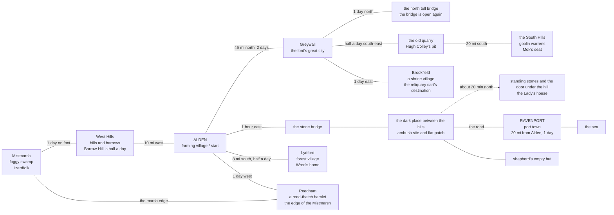

# World Settings — Alden and the Neighboring Towns

For the D&D 5e (2014 Basic Rules) campaign
Last update: 2026-11-17

## Map (towns and roads)

## Alden — the starting farming village

- Population: about 300
- A farming village in the middle of wheat fields. A river and an old watermill — the village takes its name from the mill
- Inn: **The Golden Sheaf** (the only one)
- A small shrine, a blacksmith, and a market every seven days
- A quiet village where everyone knows everyone
- Latest rumor: carts have gone missing on the road to the port
- People:
  - **The innkeeper of The Golden Sheaf** (no name given yet)
  - **The miller** (a big man at the watermill). Covered in flour; he walked the night road looking for his son
  - **Tam** (20): the miller's son. Driver of the first missing cart. Missing → sleeping under the hill
  - **Bram** (an old farmer, east farm by the river): he has not slept since his grandson went missing
  - **Will**: Bram's grandson. Driver of the second cart. He was carrying "the black box with the grey seal". Sleeping under the hill
  - **Hale** (the south farm): his brother went missing
  - **Rowan**: Hale's brother. Driver of the third cart. Sleeping under the hill
  - **Hale's wife** (no name given yet): she gave Rowan's broken lantern to Wren
  - **Meg** (the blacksmith, a woman): she rented the party her cart and horse. "The cart is free when you go for the rescue"
  - **Pip** (horse): Bram's young horse. Free for the party to use, any time
  - **Anvil** (horse): Meg's old grey horse
  - **Bram's old mare** (no name): she told Wren what happened on the night of the song
  - Visitors: the party (Punya, Karin, Wren, Noel) — arrived September 14

## The neighboring towns and lands

### East: Ravenport — the port town

- Distance: about 20 miles (1 day on foot)
- Population: about 2,000
- Ships, sailors, warehouses, and a fish market. A thieves' guild in the shadows
- Punya's Criminal Contact works here
- Farm goods from Alden are shipped out from here, and "special" cargo passes through here too
- A noisy, dangerous place, full of money and secrets
- Downtown: the market square, the guild halls, and the harbormaster's office (on its wall, a notice board: ship lists, a tax paper from Greywall, a wanted paper)
- Workplaces: the dockside warehouses — among them the **fish-oil warehouse**, whose cellar held a nest of ten giant rats until the party cleared it (Oct 4, 5 gp), and the **customs warehouse** by the east pier — the tax men's bonded store; a wererat named Nib stole from its cellar through a harbor drain tunnel for five nights, until Wren's threat banished her from Ravenport (Oct 6-7, 10 gp; every stolen thing was recovered)
- Inns and taverns:
  - **The Drunken Eel** (by the docks): an inn and tavern in one, a smugglers' house. Nobody asks names, nobody sees faces. A big room for 8 sp, dinner 3 sp
  - **The Gilded Anchor** (the market square): captains, cargo brokers, and warehouse men talk low here. Cargo talk lives here
  - **The Salty Dog** (by the fish market): the roughest house in town. Cheap beer, fast knives
  - **The Sailors' Rest** (by the fish market): cheap bunks only, 1 sp a person. Rough and dangerous
  - **The Merchant's House** (up the hill): clean, quiet, and costly (8 sp a person, meals 5 sp). Good beds, bad ears
- People:
  - **Punya's Criminal Contact**: the one who passed the "special cargo" job to Punya. His identity and true aims are still unknown
  - **Lily, the keeper of The Drunken Eel** (a fat woman, age 46): she knows Punya from his smuggling days and calls him "the old fox"
  - **Venn** (a cargo broker): his office handled the box with the grey seal. The party has not met him yet. Confirmed Sept 20: the grey seal is Venn's house mark — the signet ring's face is a ring of standing stones. He also brokered the Sept 21 silver run
  - **Pell** (Venn's young clerk): he loaded the box onto Bram's cart with his own hands. He drinks at The Gilded Anchor. Met face-to-face on Sept 20 when he collected the lost ring (reward 5 gp); the party's names are now in Venn's paperwork
  - **Hobb** (the guild's road-master): a scarred ex-guard who assigns the escort work. He has accepted the party as "the road's escort"
  - **Tobin** (a wine merchant): a thin, careful man. The party escorted his cart of six barrels to Greywall on Nov 24–26 and finished the job safely (16 gp). He wraps the barrels in straw and blankets against the cold
  - **Odo** (the merchants' factor): a dry old man whose whole work is counting. He rides with the Sept 21 silver run and holds the strongbox keys
  - **Colm** (the customs storekeeper): keeper of the bonded warehouse. He offered the party his silver tableware as spare silver, and got every stolen thing back (Oct 6-7)
  - **Nib** (a wererat, gone): a small rat-woman who stole through the harbor drain. She surrendered her whole cache to Wren's threat and left Ravenport by boat before dawn on Oct 7

### The east road and the hill of the standing stones (Alden to Ravenport)

- One hour east of Alden stands **the stone bridge**. Past it, the road passes between two hills — trees close, dark even in the day, and no birds sing. All the carts vanished here
- A flat grass patch on the south side (the ambush site; also the place for the return signal). A shepherd's empty hut on the far side of the hills
- On the north hill stand **the old standing stones**. Under them lies a door that opens only at night, and the Lady's house: the Great Hall, the Sleeping Hall, her bedroom, and behind it the Dark Room of the Fires
- People:
  - **The Lady of the Stones**: queen under the standing stones. She never leaves her house. She keeps men sleeping, and rules the pixies by holding their "lights" hostage
  - **Tansy** (pixie, green hair): one of the two captured pixies. Sharp tongue. Freed by the deal, now the party's eyes inside the hill
  - **Sorrel** (pixie): the other one. Quiet, cries often. Also freed by the deal
  - **Lira** (pixie): she said "no" once, and the Lady took her light. Now she is grey. She showed herself to the party by the road, in the day
  - **The pixie who ran** (name unknown): she escaped the fight and reported everything to the Lady
  - **The fallen pixie** (name unknown): killed by Karin in the fight on the road
  - **The Stone Hands** (two): giants with hands and arms of stone. They never talk; they only carry. They move only on the Lady's orders
  - **The sleeping knight** (name unknown): a beautiful knight who came 100 years ago to win her heart. He still sings in his sleep in her hall

### South: Lydford — the forest village

- Distance: about 8 miles (half a day on foot)
- Population: about 100
- A village of hunters and woodcutters at the edge of a deep forest. Wren's home
- Wolves and worse things live deep in the forest, and there are old ruins
- The villagers respect druids and fear the ruins
- People:
  - **Wren's home village** (she is traveling with the party now)
  - **The old druids of the deep wood**: they taught young Wren a little Sylvan
- Oct 8: the hunter Berric reports three nights of lights and eyes. The old druids' warning — the light over the marshy hollow is a **will-o'-wisp** (the ghost of a drowned pedlar), the eyes by the ruins are an **owlbear**. Both near Wren's home
- Oct 8, dusk: the party **destroyed the will-o'-wisp** at the marsh pool (Noel's Magic Missiles; she nearly fell, at 2 HP). The pedlar's pack gave 12 gp of old silver; the village paid its 4 gp fee. **The owlbear in the ruins is still there**
- Oct 9, midday: the party **killed the owlbear** in the ruins (Karin's scout and critical Sneak Attack, Punya's finishing blow; XP 175 each, everyone 735 / 900). That night the village feasted its hero. **Both of Lydford's monsters are dead.** Oct 10, morning: the party left for Greywall
- Oct 11, evening: the party reached Greywall again. Oct 12, late morning: the party took the sewers job (10 gp) — Noel cast Find Familiar as a ritual and called **Cinder**, a rat, after buying 10 gp of materials and a 1 gp brass brazier (purse 52 gp 9 sp). In the lower culvert they **killed a carrion crawler** (XP 112 each, everyone 847 / 900), and found **Dunn's bones** in the nest
- Oct 12, midday: the **second carrion crawler** attacked at the steps landing and was killed — Karin was dropped and raised (Wren's Healing Word), Punya took a critical bite shielding her (0 HP) and woke on a **natural 20** death save. The party reported to the captain, returned Dunn's badge, and was paid the **10 gp**. **The sewers are clear.** Oct 13: the party reached **Level 3**
- Oct 13, deep night: the party collected the **castle-gate bounty** — **Tomas Rask** (an escaped knife-man; scar through the left brow, three fingers on his left hand) was killed in his river-slum shack after a 3-round fight (Punya's sleeping critical left him at 1 HP); his minder Pike died with him; the second minder, Fen, surrendered, was stripped, talked, and was handed to the watch. At sunrise the sergeant paid **25 gp** against the three-fingered left hand. Rask's escape had been bought with new silver in a purse stamped with the **tax office's seal** (a bell above an open gate) — Punya keeps the empty purse. Oct 14, morning: purse **121 gp 8 sp**, XP 1,040 / 2,700

### North: Greywall — the lord's great city

- Distance: about 45 miles (2 days on foot)
- Population: about 30,000. The largest city in the region
- A lord's castle on the hill, stone walls, a great temple, merchant guilds, and guards and tax collectors at every gate
- Markets in every quarter, and an annual fair that draws thousands of people
- The law is strong, so it is a dangerous place for a man with a record. But in a city this big, a man can disappear, anything can be bought, and information flows in from everywhere
- Places the party knows:
  - **The Crown & Bell** (a tavern under the castle hill): spiced wine, 3 sp a pitcher. The party's loud arrival on Sept 29 made them famous here — the keeper sent a second pitcher free
  - **The Ferryman's Rest** (a cheap inn in the river quarter): a small room for four, 5 sp; a plain stew dinner, 2 sp a person. A family inn — the keeper **Garrick** (mid-50s, a former ferryman; a quiet man who minds his own business), his wife **Tessa** (40s, runs the kitchen), and their daughter **Nell** (age 22, serving and cleaning)
  - **The tax office** (by the castle): where wagon contracts are signed and sealed
  - **The great temple**: its crypt below — a south aisle and a north aisle of stone tombs that join at the far end. A wight and three skeletons held it until Oct 14, when the party cleared it (contract: no taking burial goods)
  - **The market hall counting room and the castle vault**: the goldsmiths count coin at the hall and sleep it in the vault; the dusk walk between them draws street crews
  - **The alchemist's shop** (by the market): kept by **Master Hess**, an older man. His apprentice is **Robb** (age 14). He made the ointment that undoes petrification from the basilisk's gullet fluid (40 gp; ordered Jan 21, ready Jan 23)
  - **Aldous's bookshop**: a shop of old and rare books, kept by **Aldous**
- People:
  - **Halloran** (the tax-master): thin, ink on his fingers, no smile. He hired the party to escort the tax wagons south (24 gp, Oct 1-3, paid in full) and speaks of them with dry respect
  - **Tomas Rask** (a knife-man, dead Oct 13): escaped the castle cells nine days before by cutting a guard; his escape was bought with new silver in a tax-sealed purse; killed by the party in his river-slum shack for the 25 gp castle-gate bounty. Minders: **Pike** (dead with him) and **Fen** (surrendered, taken by the watch)
  - **Father Corin** (the great temple's priest): sealed the crypt contract with wax — 20 gp when the crypt is quiet again; lent the party holy water, and gave a third flask after the first descent ("Aim it well, fox")
  - **Master Aubin** (the goldsmiths' man at the market hall): counts terms out like coins; paid 8 gp for the strongbox walk to the castle vault (Oct 14, dusk)
  - **Tilbury** (a cloth merchant on a market street): his shop has a storefront, a storeroom, and a cellar. A crate that came from Ravenport was a **mimic**, and the party killed it in the cellar on Nov 15 (fee 10 gp; indigo dye worth about 15 gp was recovered and returned). He is in a payment fight over the freight and the goods money with the shipper **Dace** (a Ravenport shipping agent, who bought a bankrupt dyer's stock lot at auction and sent it on) — not the party's business
  - **Osric** (a spice merchant on the market street): a fat, red-faced man. From the strongroom at the back of his shop, small rich goods — saffron, pepper, cloves, about 38 gp in all — vanished four times in two weeks, always at night. Every morning the door is locked, the lock unbroken, the walls unbroken. Osric keeps the only key. His people: **Ansel**, his clerk of six years; **Bodo**, a big porter; **Tam**, a boy who sweeps and runs. Osric sleeps over the shop with his wife and hears nothing at night. On the evening of Nov 26 the party took the job: find the way in, and the thief (15 gp). Solved on the night of Nov 26, after a stakeout and a short fight — the thief was **Ansel himself**: he hid inside before closing and opened the room with a **copied key** (a wax impression taken months before). He was captured and handed to the night watch with the key as evidence, and Osric paid the 15 gp
  - **Wick** (19, a former roofer's apprentice): a sneak thief who kept breaking in by way of roofs and skylights in the market's warehouse quarter. Caught in the party's stakeout on the night of Nov 16 and handed to the night watch (the merchants' association paid 20 gp)
  - **Marek** (master of the coach company by the east gate): a grey man with ink on his hands. When his coachman **Hart** (52, ten years on the east road) went missing, the party took the search from him on Nov 27 (12 gp). Hart's coach was found wrecked below the ford on Nov 28 — Hart, the passengers **Sella** (a woman travelling to her daughter in Greywall) and **Rye** (a young man), and the priest Oswin all drowned in the flood of Nov 13. The mail box was recovered and is being carried back to Greywall; the 12 gp is paid on the report
  - **Brookfield** (one day east of Greywall): a village with the great temple's shrine. The road is about 20 miles, with a ford halfway (about 10 miles from each town). On Nov 18–19 the party escorted the reliquary cart (the saint's casket) there (15 gp, both ways safe). The shrine priest is **Father Tolan**; his friend **Father Oswin**, a priest and coach passenger, died in the flooded ford on Nov 13. Oswin carried a **sealed box of shrine offerings** for Greywall's great temple; the box was recovered from the wreck on Nov 28. The farmer **Fenn**, on the south bank past the ford, shelters the two surviving coach horses in his barn
  - **Wilkes** (a salt merchant): his salt wagon left Alden on Dec 27 (driver Piers, guard Sten) and never reached Greywall; on Jan 4 he hired the party to search for it (12 gp). The wagon was found in a gully to the south on Jan 5, and both men were rescued (reported Jan 6; 12 gp paid). He has also hired the party to guard his salt-recovery crew (18 gp)
  - **Piers** (Wilkes's driver, in his 50s): the wagon went into the gully in the snow squall of Dec 28, and his leg was broken. He and Sten lived eight days in a tarp shelter and were rescued by the party on Jan 5. He is now recovering at Greywall's great temple
  - **Sten** (a young guard): the guard riding with the salt wagon. He kept Piers alive with frostnipped fingers, and since the rescue he stays with Piers at the temple
  - **Garv** (foreman of Wilkes's recovery crew): on Jan 9 he will lead the repair crew (four laborers, a spare wheel, two fresh horses, and a transfer wagon) into the gully to change the wheel and haul the salt out
  - **Ralf (46) and Mabel (44), and their son Hugo (17)**: a sheep farm at Greywall's north edge. The snow-wolf pack took six sheep and their old sheepdog. They sheltered the party free on the night of Jan 2, and Ralf helped salt the winter wolf's white pelt
  - **Jill** (28, a seamstress on the market street): she keeps her small shop-and-room alone. On Jan 7 she was about to be put out over back rent; Punya helped her, and he now keeps a room with her. In her whole life she has had only two partners: her village fiance, and Punya. On Jan 22, Punya asked her to bear his child, and to live together and raise it if she becomes pregnant; Jill agreed. She takes no other customers
  - **Master Rupert** (a silk merchant): the client of the silk-cart escort (18 gp). On the morning of January 31 the party set out from Greywall for the toll-bridge market (due back February 1)

### South of Greywall: the Alden road

- **Ned (52) and Tilda (49), and their son Fenn (19) — a hill farm**: 15 miles south of Greywall, on the Alden road; barley and goats. On the afternoon of Dec 28 their son Fenn saw the salt wagon pass and waved — the last sighting of the wagon. That evening a snow squall hit the hills. They sheltered the party free on the night of Jan 4
- **The salt wagon's gully**: about 9 miles south of Greywall, at a bend past the bent pines. Some 40 ft below the road lies Wilkes's salt wagon, its wheel broken (the salt still aboard). In the rocks across the gully is an **owlbear's** hollow; the dead horse has been eaten to bones. The second horse was led out on Jan 6. The salt recovery is set for Jan 9 (the party guards the crew)

### North of Greywall: the roadside inn and the bandit camp

- **The roadside inn** (8 miles north of Greywall, near the ruined watchtower): a small inn on the north road, run by only three people — the keeper **Master Hale** (in his 50s; not the farmer Hale of Alden), his wife **Edda** (kitchen and rooms), and the stable boy **Nils** (16). On the terms that they deal with the bandits, the party stayed at 3 sp a night for the four, with meals (January 24–27)
- **The bandit camp** (in a hollow about 2 miles north-east of the inn): a leader and five men, with tents of stolen cloth, salt bags and one cart. Their large scout drank with carters at the inn and asked about cargo and destinations. On the night of January 27 into the pre-dawn, the party downed the 3 watchers drawn by the inn window's "show" (one was taken prisoner) and destroyed the camp in a night raid. The two stamped cash boxes, the cloth, the salt and the cart were returned untouched; the party took only the "bare cash", 62 gp 2 sp

### North of Greywall: the toll bridge (one day north)

- A stone bridge, one cart wide, over a deep river cut (~30 ft down to the water). Deck ~80 ft long, ~10 ft wide, rising to an arch crest at mid-span. At the north end stands the **toll house** — porch, main room, and the keeper's small back room — with a yard, stable, and barrier
- The trap the deserters ran (spring – Oct 16): the house kept an **open-for-business face** (lamp lit, a "keeper" taking the normal toll). A chosen cart was waved onto the bridge; mid-span a **counterweighted drop-bar** fell at the south end (worked by a rope from the north end; raised again by one person at the south post's lever), the north gate closed, and the drivers were stripped and sent south on foot. Poor carts paid the toll and passed
- **Captain Voss** (a Veteran; walked out of the lord's army in spring) held it with **seven swords**. All seven died on **Oct 16** — two at the bridge at dusk, two awake men in silence at night, two in the main room's rush, and Voss himself at his own porch, refusing surrender, killed by a four-way volley. The toll guild paid **30 gp**; the deserters' gear was sold in Greywall (Oct 18)
- People:
  - **Petyr** (the true toll-keeper, old): chained by the ankle in the stable loft for three weeks while Voss ran his bridge. Freed by the party on Oct 16; back at his post, ringing his bell for honest tolls, and holding the recovered named goods for the guild's inspector
  - **Wat** (a cloth merchant of the north road) and **Jory** (his young spearman): lent the party their cart and mare for the bait run at a **40 gp deposit**, hiding with their cloth in the north woods; the cart and mare came back (the mare with a scar), and the deposit was returned in full
  - **The toll house cat** (fat, unnamed): rules the counter, answers to no one
- **The settlement and the "bridge market" north of the bridge**: a trading settlement at the north end of the bridge (about 180 people): toll staff, market traders, carters, warehouse keepers, a smith, and two inns. The settlement and its market stood here long before the deserters; only the market died during the three weeks the bridge was closed. Salt and silk fetch high prices in the north; furs, timber, and dried river fish come down from it. North of the settlement a road runs on between farmland and forest (the party has not been that way)
- **The North Bank inn**: an inn facing the market square. The keeper is **Benn** (46, a former carter), his wife **Alis** runs the kitchen and the desk, their daughter **Marit** (21) serves and finishes the guest rooms, and **Sam** (in his 30s) tends the stable. Six guest rooms upstairs. The party stayed here on the night of Jan 31, on the silk-cart escort

### South-east of Greywall: the old quarry and the South Hills

- **The old quarry** (half a day south-east of Greywall): Hugh Colley's pit. The stone here is still good — the pit closed ten years ago because the old owner died and the lord's building works had ended, not because it was worked out. His son **Hugh Colley** is reopening it now that the castle is buying stone for its walls again
- Late Aug – Oct 31: a goblin band under the bugbear **Mok** (about 16 goblins) held the dry upper tunnels and raided the south farms by night. Hugh posted **12 gp** (Oct 27) to have them gone
- Oct 28–31, the party settled it without a quarry fight: a sheep as a greeting gift, two nights of feeding Yark's wolves, and a third-night strike at Yark's warren (below). Mok's band left the pit at dawn on **Oct 31** and marched home to the South Hills. The pit stands empty; Hugh's 12 gp is still to be reported and claimed
- **The South Hills** (20 mi south of the quarry; about 32 mi south of Greywall, some 13 mi north of Alden): grass hills with goblin warrens (cave dens), long held by the united band of the chief **Greth** — about 50 goblins in the spring
- Greth died in the spring (a stone fall in the deep warren). The band split and fought: **Yark**, a goblin boss with more spears (about 26, plus five wolves), held the warrens; the loser **Mok** took his followers north to the quarry
- **Oct 31, before dawn**: Yark was killed in his own deep chamber (the party's knives; Mok's band and the turned wolves in the dens). Mok took Greth's **silver torc** and the seat, uniting both bands (about 30 goblins, plus the five wolves) under an oath sworn to the party: **no more raids on Greywall's farms**, and the quarry left empty
- People:
  - **Hugh Colley** (quarry owner): posted the 12 gp. "I sell stone. I do not dig goblins."
  - **Joss** (a stonemason): Colley's man. He was turned to stone by the basilisk at the pit bottom in mid-December, and the ointment brought him back to flesh on Jan 23. His wife **Beth** and their 7-year-old son live in Greywall
  - **Rudd** (a stonemason): Colley's man, petrified together with Joss and restored on Jan 23. He is single, and lives in Greywall with his widowed mother **Greta**
  - **Mok** (bugbear; chief of both bands from Oct 31): proud and oath-bound — his word is stone. On Nov 5, trusting Punya's word, he took in the last five of Yark's band (Snag, Wort, Old Pess, Tib, Skree) as kneelers (Pess is his cook now)
  - **Yark** (goblin boss, dead Oct 31) and **Greth** (the old chief, dead in the spring)

### West: The West Hills and the Mistmarsh

- The hills begin about 10 miles west of the village
- Grass hills and the barrows (burial mounds) of old kings. Small hamlets of shepherds here and there
- The biggest hamlet, **Barrow Hill** (about 60 people), is half a day on foot
- Past the hills, one day on foot, lies the **Mistmarsh**: a foggy swamp of black water and dead trees. Lizardfolk live there, and travelers often get lost
- Rumor: at night, blue lights float over the barrows. Near the marsh, shepherds have lost whole flocks of sheep, with no tracks left behind
- People: the **headman of Barrow Hill** (an old shepherd, unnamed) — he confirmed the grave-robbers' bodies, marked the reward paper, and gave the party free food and beds (Sept 24)
- **Reedham** (on the edge of the Mistmarsh, one day west of Alden): a hamlet of some 14 reed-thatched houses. Its stores are smoked marsh fish and eels. The headman's barn loft is the travelers' bed. The headman's old dog **Patch** (an old hand at herding sheep)
  - **The gift stone**: a great stone between the hamlet and the marsh. In hard winters, an old custom leaves a basket of smoked fish and eels (about 20 lb) there — "insurance", so the marsh folk eat the gift and leave the flocks alone
- **The lizardfolk village** (on reed-and-mud islets in the Mistmarsh): a village of reed-and-mud huts. Their ground is marked by totems (a heron's skull and bound reeds). They live by their fish weirs. Their tongue is **Draconic**. They have no darkvision
  - **The white-jaw elder** (leader of a hunting band): he gave Noel the **bone fish token** (show it on the water, and their spears stay down)
  - **The old shaman woman** (a staff of bone and reed): she rules on questions of custom
  - **Kressh** (leader of the young hunters): the one who led the five hungry young hunters who took Reedham's sheep after the weirs broke (see the settlement below)
- **The missing sheep are settled (Nov 11)**: the autumn floods broke the lizardfolk's fish weirs, and five young hunters (Kressh's band) had been taking Reedham's **41 sheep** along the water channels (laying woven reed mats to wipe away their tracks). The party did not accuse them; it brought the gift basket twice, and the tribe came forward on its own with terms: the raids stop at once, the young ones stay inside the totems, Kressh repairs the weirs all winter, a basket of smoked goods goes to the gift stone every month until spring (about half of the loss), and Kressh's spear is left at the gift stone for a season (the rite was held on Nov 14). Reedham's headman paid the fee of **15 gp**

## The job (why the party is in Alden)

A job from Punya's contact in the port town of Ravenport. Carts have gone missing on the road between Alden and Ravenport, and one of the missing carts carried "special" cargo. Find out what is happening — quietly. The pay is good, and a clean, quiet job like this builds the name of the greatest thief that ever lived.

## Clues and hooks (what the party has learned)

Clues, information, and open hooks from the story, gathered here by place.

### Ravenport (September 17, night — from the notice board and listening at The Gilded Anchor)

- **Venn**: a cargo broker. Three weeks ago, his office took the "black box with the grey seal", which came in on the ship Grey Gull. The deal was "no questions". His link to Punya's Contact is unknown
- **Pell**: Venn's young clerk (about 20, thin). He loaded the box onto Bram's cart (driver Will) with his own hands. He drinks at The Gilded Anchor, drinks little, and laughs too fast (he looks nervous). A man to question (the plan: tonight only watch him, words tomorrow)
- **The Grey Gull** (ship): the ship that brought the box. A story in the market: one of her sailors was paid in **old silver** — a coin with a dead king's face. The men laughed at him and called it "barrow silver"
- **The guild notice** (notice board): "The Alden road is not safe." Guild carts now travel with escorts, and escorts are wanted. Also a work hook
- **The wanted paper** (notice board): "Grave-robbers at the western barrows." By order of Greywall, a reward of 10 gp for true word. A badly drawn face. This may connect to the box: the thing inside may be something stolen from a barrow
- **The tax paper** (notice board): Greywall's new port taxes (salt, cloth, wine). The merchants are angry — and angry men talk
- **The Widow's Kiss** (ship): sails tomorrow (September 18) at first light, for the south ports
- **Lily (The Drunken Eel)**: she knows Punya from his smuggling days and calls him "the old fox". She may be a source by the docks

### Alden and the east road

- **The rescue is on hold**: the party will go into the Lady's house only after they have leveled up (Yamamoto's call: hold until Level 5, 2026-11-14). The deal with the two pixies (Tansy and Sorrel) and the return signal (the voice call: "Chinpyoro-supōn!") are in place
- **The signal test worked (the night of Nov 21)**: the party tried the signal at the flat grass patch, and one light answered (= safe). **The deal is still alive.** Wren called out in Sylvan, and Tansy answered with her voice only: nothing has changed below (the men still sleep; the cups, and Lira's empty cup, are as they were). The other pixies hold no ill will, but some are timid, and if they are told to "sing", there are those who cannot refuse (Tansy and Sorrel keep their promise not to sing against the party). **The Stone Hands, in Tansy's account, come to "two voices and footsteps"** (one by the door, the other around the Great Hall and the kitchen) — but she herself says she cannot swear there are only two
- **Lira seen** (September 17, day): the grey, lightless pixie watched the party from the shade by the road between the hills. With no light, she can move hidden in the day
- **Meg's offer**: the cart is free for the rescue run (if Anvil comes back alive)
- **Bram's offer**: his young horse Pip is free for the party, any time
- **The sleeping men** (Tam, Will, Rowan): they sleep on under the hill, not growing old and not suffering — so there is no need to hurry, but the plan is to return in weeks, before the Lady's plans for the box move on

### Greywall

- **The tax seal on Rask's escape (new, Oct 13)**: the knife-man Rask's escape from the castle cells was bought with new silver, delivered in a sealed purse stamped with a **bell above an open gate — the tax office's revenue mark** (the same stamp as the tax papers on the board). The second warder on duty "looked at the moon." Fen, who carried the story, knows no name; the money came "from up the hill." The empty purse is in Punya's pocket, beside the bandit's note from the silver run — *a second piece of paper pointing at offices, not streets*
- **The tax wagons (done)**: the party escorted Halloran's four wagons south Oct 1-3 for 24 gp, paid in full. The Oct 2 valley ambush (a Spy-chief, a Thug, and two Bandits on the party's screen; two guards died on the guards' screen) was beaten off — port men tried to stop the tax, and now know the party's faces. Greywall's collection began Oct 1
- **Work in Greywall** (status as of Oct 18): the sewers under the market — DONE Oct 12 (two carrion crawlers killed, Dunn's badge returned, 10 gp paid); the castle-gate bounty — DONE Oct 13-14 (Rask killed, 25 gp paid); the great temple's crypt — DONE Oct 14 (a wight and three skeletons destroyed, 20 gp paid; the wight's sword and mail left in its tomb); the goldsmiths' strongbox walk — DONE Oct 14 at dusk (a street crew routed in the tanners' lane, 8 gp paid); the deserters on the north road — DONE Oct 16 (all seven dead at the toll bridge; bridge open, the keeper Petyr restored; 30 gp paid, the gear sold Oct 18). Still open: a granary night guard (4 gp); the charcoal burners' wolves (6 gp, posted Oct 15); the river mill wheel at night (10 gp, posted Oct 15, unknown); the Mistmarsh sheep (~15 gp). The lord's boar hunt rode out Oct 15 without the party

### Greywall work (updated Nov 28)

- **Done**: the granary night guard (Oct 18–19, 4 gp), the charcoal burners' wolves (Oct 19, 6 gp), the ghost at the river mill (Oct 20–21, 10 gp; Corin's specter laid to rest by burial), the harpies at the old south watchtower (Oct 22, 8 gp), the ogre on the west road (Oct 23–25, 20 gp), the goblins at the old quarry (Nov 1, 12 gp; settled by talking, as above), the plague-field graves (Nov 1–2, 10 gp; a family of ghouls driven off), the Mistmarsh sheep (Nov 11, 15 gp), Tilbury's biting crate = a mimic (Nov 15, 10 gp), the capture of the rooftop thief Wick (Nov 16, 20 gp), the temple's reliquary cart escort (Nov 18–19, 15 gp), the wine cart escort (Tobin's, of Ravenport, Nov 24–26, 16 gp), the locked-strongroom theft (Nov 26 night, 15 gp — the thief was the clerk Ansel: hiding inside before closing, a copied key; captured and handed to the night watch)
- **In progress**: the missing coachman (12 gp, taken from Marek on Nov 27). On Nov 28 the coach's wreck and all four deaths were confirmed below the ford; the mail box and the offerings box were recovered, and the bodies were hauled onto the high bank and covered with stones and branches. The job closes on the report to Marek in Greywall
- **On the board now (Nov 27)**: the pay-chest escort to the toll bridge (two days there and back, 10 gp), noises in a widow's house on Tanner's Row (8 gp), a great boar in the south farms (12 gp)
- **Alden's sheep thief (Nov 22)**: a **manticore** that had taken three sheep from the high pastures was killed in an ambush beside the fold (the village paid 8 gp; Meg offered free repairs and shoeing)

### Greywall work (updated Jan 31)

- **Done**: the bandits on the north road (January 28, 20 gp — the road guild, contact Master Sorn; one prisoner and the recovered goods handed to the authorities)
- **In progress**: the silk-cart escort (18 gp, Master Rupert; out January 31, due back February 1)
- **On the board (from January 29)**: #7 skeletons in the cemetery below the castle (15 gp, the temple), #8 a gold box under the ice at the ford on the Brookfield road (12 gp). The will-o'-wisp at the sunken chapel (12 gp, Father Tolan's formal request) is also untouched

### The west (the West Hills and the Mistmarsh)

- **Blue lights over the barrows**: at night, blue lights float over the graves — seen again over the Long Barrow on the night of Sep 23, while the robbers dug below. Barrow Hill lore: they are **the old kings, checking their doors**; they walk the barrows only and have **never** come down into the village — no attacks, no one taken
- **The sheep disappearing**: near the Mistmarsh, whole flocks are lost with no tracks (not looked into yet)
- **The grave-robbers' wanted paper**: posted in Ravenport (above). A possible link between the western barrows and the box in the port. Sep 24: the party killed both men in the old quarry; the village's paper makes the **10 gp reward claimable in Ravenport**. Their charcoal map shows three chambers in the Long Barrow — one robbed weeks ago, one their next dig, **one untouched and left sealed**
