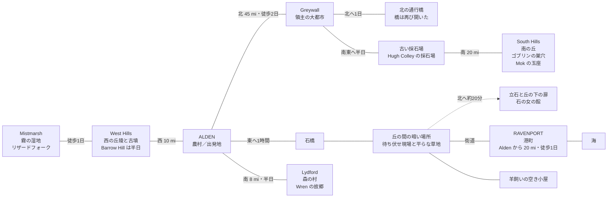

# 世界設定 — Alden と周辺の町

D&D 5e（2014 Basic Rules）キャンペーン用
最終更新: 2026-11-13

## 地図（町と道）

## Alden（アルデン）— 出発地の農村

- 人口: 約300人
- 麦畑に囲まれた農村。川と古い水車小屋があり、村の名前の由来になっている
- 宿屋: **The Golden Sheaf**（1軒だけ）
- 小さな神殿、鍛冶屋、7日ごとに開かれる市場
- みんなが顔見知りの静かな村
- 最近の噂: 港への道で荷馬車が消えている
- 登場人物:
  - **宿屋 The Golden Sheaf の主人**（名前はまだ出ていない）
  - **粉屋**（水車小屋の大男）。粉だらけで、息子を捜して夜の道を歩いた
  - **Tam**（20）: 粉屋の息子。最初の荷車の御者。行方不明 → 丘の下で眠っている
  - **Bram**（川沿い、東の農場の老人）: 孫が行方不明になってから眠れていない
  - **Will**: Bram の孫。2台目の荷車の御者。「灰色の封の黒い箱」を運んでいた。丘の下で眠っている
  - **Hale**（南の農場）: 弟が行方不明
  - **Rowan**: Hale の弟。3台目の荷車の御者。丘の下で眠っている
  - **Hale の妻**（名前はまだ出ていない）: Rowan の壊れたランタンを Wren に託した
  - **Meg**（鍛冶屋の女主人）: パーティに荷車と馬を貸した。「救出のときは荷車はタダでいい」
  - **Pip**（馬）: Bram の若い馬。パーティにはいつでも無料で貸し出す約束
  - **Anvil**（馬）: Meg の老いた灰色の馬
  - **Bram の老牝馬**（名前なし）: 歌の夜に起きたことを Wren に語った
  - 来訪者: パーティ（Punya、Karin、Wren、Noel）— 9月14日に到着

## 周辺の町と土地

### 東: Ravenport（レイヴンポート）— 港町

- 距離: 約20マイル（徒歩1日）
- 人口: 約2,000人
- 船、水夫、倉庫、魚市場。影には盗賊ギルド
- Punya の Criminal Contact がここにいる
- Alden の農産物はここから出荷され、「特別な荷物」もここを通る
- 騒がしくて危険、お金と秘密の集まる場所
- 中心部: 市場の広場、ギルドの建物、港湾管理事務所（壁に掲示板: 船のリスト、Greywall からの税の布告、指名手配の紙）
- 職場: 波止場の倉庫群——その1つ **魚油の倉庫**。地下室に巨大ネズミ10匹の巣があったが、10/4 にパーティが退治した（5 gp）。もう1つ、東の波止場の **税関倉庫**——税の保税倉庫。ワーラットの Nib が港の排水トンネルから5晩盗みを続けたが、Wren の脅しで街から追放された（10/6–7、10 gp。盗品は全回収）
- 宿屋・酒場:
  - **The Drunken Eel**（波止場）: 宿と酒場を兼ねる密輸者の店。名を聞かれず、顔を見られない。大きな部屋 8 sp、夕食 3 sp
  - **The Gilded Anchor**（市場の広場）: 船長、荷の仲買人、倉庫の人間が静かに話す店。荷の話はここ
  - **The Salty Dog**（魚市場のそば）: 町で一番荒い店。安い酒と早いナイフ
  - **The Sailors' Rest**（魚市場のそば）: 安い寝台だけの宿（1人 1 sp)。粗末で危ない
  - **The Merchant's House**（丘の上）: 清潔で静かな高級宿（1人 8 sp、食事 5 sp)。ただし情報は入ってこない
- 登場人物:
  - **Punya の Criminal Contact**（連絡係）: 「特別な荷物」の仕事を Punya に回した人物。正体と本心はまだ不明
  - **The Drunken Eel の女将**（太った女、名前はまだ出ていない）: Punya の密輸時代からの顔なじみ。彼を「old fox」と呼ぶ
  - **Venn**（荷の仲買人）: 灰色の封の箱を取り扱った事務所の主。まだ会っていない。9月20日判明:灰色の封は Venn 商会の印で、印章指輪の印面は「立石の輪」。9月21日の銀の輸送も彼が取り仕切った
  - **Pell**（Venn の若い事務員）: 箱を自分の手で Bram の荷車に積んだ。The Gilded Anchor に出入りする。9月20日、落とし物の指輪の受け取り時に初対面（謝礼 5 gp）。パーティの名前が Venn の書類に残った
  - **Hobb**（ギルドの road-master）: 元衛兵の傷顔の男。護衛仕事の差配をする。パーティを「街道の護衛」として認めた
  - **Odo**（商人側の係、factor）: 数えることが仕事の乾いた老人。9月21日の銀の輸送に同行し、金庫の鍵を持つ
  - **Colm**（税関倉庫の管理人）: 保税倉庫の番人。予備の銀として税関の銀器の貸し出しを申し出て、盗品を全部取り戻した（10/6–7）
  - **Nib**（ワーラット、退場）: 港の排水溝から盗みを働いていた小柄な鼠女。Wren の脅しに隠し場所ごと降参し、10/7 の夜明け前に船で Ravenport を去った

### 東の街道と立石の丘（Alden から Ravenport へ）

- Alden から東へ1時間で**石橋**。その先、街道は2つの丘の間を通る——木が近くて昼でも暗く、鳥が鳴かない場所。荷車は全部ここで消えた
- 南側に平らな草地（待ち伏せ現場、帰還の合図をする場所）。丘の向こう側に羊飼いの空き小屋
- 北の丘の上に**古い立石**。その下に「夜だけ開く扉」と、石の女の館がある: 大広間、眠りの間、彼女の寝室、その奥に炎の暗い部屋
- 登場人物:
  - **石の女（The Lady of the Stones）**: 立石の下の女王。館から外へは出ない。男たちを眠らせて集め、ピクシーたちの「光」を人質に支配する
  - **Tansy**（ピクシー、緑の髪）: 捕まった2匹のうちの1匹。口が立つ。取引の上で解放され、パーティの内通者になった
  - **Sorrel**（ピクシー）: もう1匹。おとなしく、よく泣く。同じく解放され内通者に
  - **Lira**（ピクシー）: 「ノー」と言った罰に光を奪われ、灰色になった。昼間、街道でパーティの前に姿を現した
  - **逃げたピクシー**（名前不明）: 戦いから逃げて、石の女に一部始終を報告した
  - **倒されたピクシー**（名前不明）: 街道の戦いで Karin に倒された
  - **Stone Hands**（2体）: 石の手と腕を持つ巨人。喋らず、ただ運ぶ。石の女の命でだけ動く
  - **眠れる騎士**（名前不明）: 100年前、彼女の心を勝ち取ろうとして入ってきた美男の騎士。今も広間で眠りながら歌っている

### 南: Lydford（リドフォード）— 森の村

- 距離: 約8マイル（徒歩半日）
- 人口: 約100人
- 深い森のふちにある、猟師と木こりの村。Wren の地元
- 森の奥には狼より恐ろしいものがいて、古い遺跡がある
- 村人はドルイドを敬い、遺跡を恐れている
- 登場人物:
  - **Wren** の出身地（現在はパーティと旅をしている）
  - **森の奥のドルイドの古老たち**: 子供の頃の Wren に Sylvan を少し教えた
- 10月8日: 猟師 Berric が3晩つづく光と目を報告。古老たちの警告——沼のくぼ地の光は**ウィル・オ・ウィスプ**（溺れた行商人の幽霊）、遺跡の目は**オウルベア**。どちらも Wren の故郷の近く
- 10月8日 夕暮れ: パーティは沼の池で **ウィル・オ・ウィスプを倒した**（Noel の Magic Missile。彼女は HP 2 まで追い詰められた）。行商人の鞄から古い銀貨 12 gp、村の謝礼 4 gp。**遺跡のオウルベアはまだ残っている**
- 10月9日 正午: パーティは遺跡で **オウルベアを倒した**（Karin の偵察とクリティカルな Sneak Attack、Punya のとどめ。XP 各 175、全員 735 / 900）。夜は村の宴と Karin の報酬。**Lydford の2つの化け物は両方とも倒された**。10月10日朝、パーティは Greywall へ発った
- 10月11日 夕方: パーティは再び Greywall に着いた。10月12日 昼前: パーティは下水道の仕事を受けた（10 gp）——Noel は儀式で Find Familiar を唱えてネズミの **Cinder** を呼んだ（材料 10 gp と真鍮の火鉢 1 gp を購入、財布 52 gp 9 sp）。下の水路で **キャリオン・クロウラーを1匹倒した**（XP 各 112、全員 847 / 900）。巣で **Dunn の骨を見つけた**
- 10月12日 正午: **2匹目のキャリオン・クロウラー** が階段の踊り場で襲い、倒された —— Karin は倒れて Wren の Healing Word で蘇生、Punya は彼女を庇ってクリティカルの噛みつきを受け（0 HP）、Death Save の **自然な20** で目覚めた。隊長に報告し、Dunn の記章を返し、**10 gp** を受け取った。**下水道は片付いた。**10月13日: パーティは **レベル3** に到達
- 10月13日 深夜: パーティは **城門の懸賞** を完了——**Tomas Rask**（脱獄したナイフ男。左の眉を横切る傷あと、左手の指3本）が川沿いのスラムの小屋で3ラウンドの戦いの末に死亡（Punya の睡眠中クリティカルで残り1 HPだった）。見張りの Pike も死亡、もう1人の Fen は降伏し、身ぐるみ剥がれて話し、衛兵に引き渡された。夜明けに軍曹が指3本の左手と引き換えに **25 gp** を支払った。Rask の脱獄は、**税務署の印（門の上の鐘）** が押された財布に入った新しい銀貨で買われていた——空の財布は Punya が保管。10月14日 朝: 財布 **121 gp 8 sp**、XP 1,040 / 2,700

### 北: Greywall（グレイウォール）— 領主の大都市

- 距離: 約45マイル（徒歩2日）
- 人口: 約30,000人。この地方で一番大きい都市
- 丘の上に領主の城、石の城壁、大神殿、商人ギルド、各門に衛兵と税金取り
- 各地区に市場があり、年に一度の大市には何千人も集まる
- 法が強いので前科のある者には危険。ただし大きい都市は人も紛れやすく、何でも買えて、情報が集まる
- パーティが知る場所:
  - **The Crown & Bell**（城の丘の下の酒場）: スパイスワイン1ピッチャー 3 sp。9/29 の騒ぎでパーティが有名になった店——店主が2杯目を奢った
  - **The Ferryman's Rest**（川沿い地区の安宿）: 4人用の小部屋 5 sp、質素なシチューの夕食 1人 2 sp
  - **税務署**（城のそば）: 荷車の契約を結び封をする場所
  - **大神殿**: その下の地下墓地——石の墓が並ぶ南の通路と北の通路があり、最奥でつながっている。ワイト1体とスケルトン3体が巣くっていたが、10月14日にパーティが制圧した（契約: 副葬品には手を出さない）
  - **市場ホール（market hall）の計算室と城の金庫室**: 金細工師たちはホールで硬貨を数え、金庫室で眠らせる。夕暮れのその道のりは、通りの盗賊団を引き寄せる
- 登場人物:
  - **Halloran**（税務長官）: 痩せていて指にインク、笑わない男。税の荷車の護衛としてパーティを雇った（24 gp、10/1–3、全額支払い済み）。乾いた敬意をもって彼らを語る
  - **Tomas Rask**（ナイフ男、10月13日死亡）: 9日前に衛兵を斬って城の牢から脱走。脱獄は税の封が押された財布に入った新しい銀貨で買われていた。城門の懸賞25 gpのため、川沿いのスラムの小屋でパーティに殺された。見張り: **Pike**（共に死亡）と **Fen**（降伏、衛兵が連行）
  - **Corin 神父**（大神殿の司祭）: 地下墓地の契約に蝋で封をした——墓地が静かになれば 20 gp。聖水の小瓶を貸し、1回目の降下の後には3本目をくれた（「Aim it well, fox」）
  - **Master Aubin**（市場ホールの金細工師側の男）: 条件を硬貨のように数え上げる男。城の金庫室までの金庫箱護衛に 8 gp を支払った（10月14日、夕暮れ）

### Greywall の北: 通行橋（北へ1日）

- 深い川の渓谷（水面まで約30フィート）に架かる、一荷車幅の石橋。橋面は長さ約80フィート、幅約10フィート、中央でアーチ状に盛り上がる。北詰に **詰所**——玄関、大部屋、係員の小部屋——と庭、馬小屋、関門がある
- 脱走兵が回していた罠（春〜10月16日）: 詰所は **営業中の顔** を保っていた（灯りがつき、「係員」が通常の通行料を取る）。選ばれた荷車は橋に通され、真ん中で南端に **釣り合い重りの落下バー** が落ち（北端からの縄で作動、南の支柱のレバーで1人が再び上げる）、北の門が閉まり、御者は身ぐるみ剥がれて南へ徒歩で解放。貧しい荷車は通行料を払って通れた
- **Voss 隊長**（Veteran。春に領軍を脱走）が **7人の剣** で橋を保持。7人全員が **10月16日** に死亡——夕暮れに橋で2人、夜に静かに目覚めた2人、大部屋の突入で2人、そして Voss 本人は自分の玄関先で、投降を拒んで、4方向の一斉射撃で。通行ギルドは **30 gp** を支払い、脱走兵の装備は Greywall で売却された（10月18日）
- 登場人物:
  - **Petyr**（本来の通行係、老人）: Voss が橋を回す間、3週間馬小屋の屋根裏で足首に鎖をつながれていた。10月16日にパーティが解放。持ち場に復帰し、正直な通行料に小さな鈴を鳴らしている。回収された名前入りの品々はギルドの査察員のために保管中
  - **Wat**（北の街道の布商人）と **Jory**（若い槍持ちの護衛）: 囮の作戦のため、**保証金 40 gp** で荷車と牝馬を貸し、布と一緒に北の森で隠れて待った。荷車と牝馬は戻り（牝馬には傷跡）、保証金は全額返済された
  - **詰所の飼い猫**（太い、名前なし）: カウンターの主。誰の言うことも聞かない

### Greywall の南東: 古い採石場と South Hills（南の丘）

- **古い採石場**（Greywall の南東、半日）: Hugh Colley の採石場。石はまだ良い——10年前に閉まったのは掘り尽くしたからではなく、元の主人が亡くなり、領主の建築工事が終わったから。息子の **Hugh Colley** が、城が城壁用に石を買い始めた今、再開を進めている
- 8月下旬〜10月31日: バグベアの **Mok** に率いられたゴブリンの一味（約16）が、乾いた上層の坑道を占拠し、夜に南の農場を襲った。Hugh は「いなくなること」に **12 gp** の懸賞を出した（10月27日）
- 10月28〜31日: パーティは採石場では戦わずに決着させた。挨拶の羊1頭、Yark の狼への2夜の餌付け、そして3夜目の Yark の巣穴への襲撃（下記）。Mok の一味は **10月31日** の夜明けに採石場を去り、南の丘へ帰還した。採石場は空。Hugh の 12 gp はこれから報告・請求する
- **South Hills（南の丘）**（採石場の南 20 mi、Greywall の南 約32 mi、Alden の北 約13 mi）: ゴブリンの巣穴（洞窟の住処）のある草の丘陵。長く、首領 **Greth** の統一した一味（春時点で約50）の土地だった
- Greth は春に死んだ（巣穴の深部での落石）。一味は分裂して争い、槍の多いゴブリンボスの **Yark**（約26、狼5頭つき）が巣穴を保持し、敗れた **Mok** は従者たちを連れて北の採石場へ移った
- **10月31日 未明**: Yark は自らの深部の間で殺された（刃はパーティ、巣穴内では Mok の一味と寝返った狼たち）。Mok は Greth の **銀のトルク** と玉座を取り、両一味（約30、狼5頭）を統一した。パーティへの誓い: **Greywall の農場はもう襲わない**こと、採石場を空けること
- 登場人物:
  - **Hugh Colley**（採石場の主人）: 12 gp の懸賞を出した。「石は売る。ゴブリンは掘らない」
  - **Mok**（バグベア、10月31日から両一味の首領）: 誇り高く、誓いを重んじる——彼の言葉は石
  - **Yark**（ゴブリンボス、10月31日に死亡）と **Greth**（前首領、春に死亡）

### 西: West Hills（西の丘陵）と Mistmarsh（ミストマーシュ）

- 丘陵は村から西へ約10マイルで始まる
- 草の丘と、古い王たちの墳墓（barrow）。羊飼いの小さな集落が点在
- 一番大きな集落 **Barrow Hill**（人口約60人）まで徒歩半日
- 丘の先、徒歩1日で **Mistmarsh**: 霧の湿地。黒い水と枯れ木、リザードフォークが住み、旅人はよく迷う
- 噂: 夜、墳墓の上に青い光が漂う。湿地近くの羊飼いの羊が、跡形もなく群れごと消えている
- 登場人物: **Barrow Hill の村長**（老いた羊飼い、名前なし）——墓荒らし2人の死体を確認し、懸賞の書面に印を押し、パーティに食事と寝床を無料で提供した（9/24）。Mistmarsh のリザードフォークは未登場

## 依頼の概要（パーティが Alden にいる理由）

港町 Ravenport の Punya の連絡係から頼まれた仕事。Alden と Ravenport の間の道で荷馬車が消えていて、消えた荷車の1台には「特別な荷物」が積まれていた。静かに調べること。報酬はたっぷりあり、「史上最高の盗賊」の名を上げるための仕事でもある。

## 手がかりとフック（得られた情報）

物語の中で判明した手がかり・情報・未回収のフックを地名ごとに集める場所。

### Ravenport（9月17日夜、掲示板と The Gilded Anchor の聞き耳で判明）

- **Venn（ヴェン）**: 荷の仲買人。3週間前、船 Grey Gull で着いた「灰色の封の箱」を彼の事務所が引き受けた。条件は「質問なし」。Punya の Contact との関係は不明
- **Pell（ペル）**: Venn の若い事務員（20歳くらい、細身）。自分の手で、箱を Bram の荷車（御者 Will）に積んだ本人。The Gilded Anchor に出入りし、酒が少なく笑いが速い（緊張気味）。聞き込み候補（方針: 今夜は見るだけ、言葉は明日）
- **Grey Gull（船）**: 箱を運んできた船。その船員の一人が「死んだ王の顔がついた古い銀貨」で支払われ、市場で笑いものになったという噂（"barrow silver" と呼ばれた）
- **ギルドの告知**（掲示板）: 「Alden への街道は危険」。ギルドの荷車は護衛つきで運行し、護衛を募集中。仕事のフックでもある
- **指名手配の紙**（掲示板）: 「西の古墳群の墓荒らし」。Greywall の命令で、確かな情報に懸賞 10 gp。下手な似顔絵つき。箱の中身が「古墳から盗まれた何か」である可能性への接続
- **税の布告**（掲示板）: Greywall の新しい港税（塩・布・ワイン）で商人たちは不満たらたら。酒場で話が弾む材料
- **The Widow's Kiss（船）**: 明日（9月18日）の夜明けに、南の港へ向けて出航予定
- **The Drunken Eel の女将**: Punya の密輸時代からの顔なじみ。彼を "old fox" と呼ぶ。波止場の情報源になりうる

### Alden と東の街道

- **救出は保留中**: 石の女の館への侵入は、パーティがレベルを上げてから。ピクシー2匹（Tansy、Sorrel）との約束と、帰還の合図（声の合言葉「ちんぴょろすぽーん！」）は成立済み
- **Lira の目撃**（9月17日昼）: 光のない灰色のピクシーが、丘の間の街道の木陰からパーティを見ていた。光がないため昼でも姿を隠して動ける
- **Meg の申し出**: 救出作戦のときは荷車を無料で貸す（Anvil が無事に戻れば）
- **Bram の申し出**: 若馬 Pip はいつでも無料で使ってよい
- **眠っている男たち**（Tam、Will、Rowan）: 丘の下で眠り続け、年も取らず苦しんでもいない前提。急ぐ必要はないが、石の女の箱を巡る計画が進む前に戻るのが方針（週単位）

### Greywall

- **Rask の脱獄に押された税の印（新情報、10月13日）**: ナイフ男 Rask の脱獄は新しい銀貨で買われ、銀貨は **門の上の鐘——税務署の印** が押された財布で届いた（掲示板の税の文書と同じ印）。当直のもう1人の看守は「月を見ていた」。話を運んだ Fen は名前を知らない。金は「丘の上から」来た。空の財布は Punya の懐の中、銀の荷車の襲撃メモの隣にある——*役所を指す2枚目の紙*
- **税の荷車（完了）**: 10/1–3、Halloran の荷車4台を南へ護衛し 24 gp を全額受け取った。10/2 の森の谷の襲撃（パーティ側の相手は Spy の頭目、Thug、Bandit 2人。衛兵側では衛兵2人が死んだ）は退けた——港の男たちが税を止めようとし、今やパーティの顔を知っている。徴収は 10/1 開始
- **Greywall の仕事**（10月18日時点）: 市場の下の下水道——**10月12日に完了**（キャリオン・クロウラー2匹を討伐、Dunn の記章を返却、10 gp 受領）。城門の懸賞——**10月13–14日に完了**（Rask 死亡、25 gp 受領）。大神殿の地下墓地——**10月14日に完了**（ワイト1体とスケルトン3体を討伐、20 gp 受領。ワイトの剣と鎧は墓に残した）。金細工師の金庫箱護衛——**10月14日夕暮れに完了**（なめし革通りで通りの盗賊団を退散させ、8 gp 受領）。北の街道の脱走兵——**10月16日に完了**（通行橋で7人全員が死亡。橋は開き、係員 Petyr が復帰。30 gp 受領、装備は10月18日に売却）。未完了: 穀倉の夜警（4 gp）。炭焼きの狼（6 gp、10月15日の掲示）。夜の川の水車（10 gp、10月15日の掲示、正体不明）。Mistmarsh の羊（約15 gp）。領主の猪狩りはパーティ不参加のまま10月15日に出発した

### 西（West Hills と Mistmarsh）

- **古墳の青い光**: 夜、墳墓の上に青い光が漂うという噂——9/23 夜、泥棒が掘る下で Long Barrow の上をまた歩いた。Barrow Hill の言い伝え: 光は**昔の王たちが自分の墓の戸締まりを確認している姿**。古墳の上だけを歩き、村に下りてきたことは**一度もない**——襲撃なし、連れ去りなし
- **羊の消失**: Mistmarsh 近くの羊飼いの羊が、跡形もなく群れごと消えている（未調査）
- **墓荒らしの指名手配**: Ravenport の掲示板にあり（上記）。西の古墳と港の箱を結ぶ鎖の候補。9/24: パーティが男2人を古い石切場で殺した。村の書面で **10 gp の賞金が Ravenport で請求可能**。男たちの木炭の地図には Long Barrow の部屋が3つ——1つは数週間前に荒らされ、1つは今夜掘る予定、**1つは手つかずで封じたまま**
